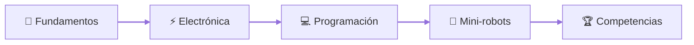

<!--

---

## ¡Te esperamos!

¡Hola!

Estamos emocionados de invitarte nuevamente al curso online de **Robotica76**. Prepárate para seguir explorando el fascinante mundo de la robótica, aprender nuevas habilidades y conectar con una comunidad apasionada.

### ¿Cómo unirte?

Es muy sencillo. Haz clic en el siguiente enlace para reincorporarte al curso y continuar tu aprendizaje:

[**Haz clic aquí para acceder a la clase de Robotica76**](https://teams.microsoft.com/dl/launcher/launcher.html?url=%2F_%23%2Fl%2Fmeetup-join%2F19%3Ameeting_NjlkMjZiOWItYjUwYi00YTgwLTg1OGEtM2ExYzc0NTllNzc4%40thread.v2%2F0%3Fcontext%3D%257b%2522Tid%2522%253a%2522ceb177bf-013b-49ab-8a9c-4abce32afc1e%2522%252c%2522Oid%2522%253a%2522e1308f86-b0c8-478f-8e8c-5c889a439261%2522%257d%26anon%3Dtrue&type=meetup-join&deeplinkId=e93b2070-0d88-4f82-aa10-c8858eda1c84&directDl=true&msLaunch=true&enableMobilePage=true&suppressPrompt=true)

⏰ ¡Horario del Curso!

¡Prepárate para sumergirte en el mundo de la robótica! Hemos establecido un horario que se adapta a tu semana, permitiéndote aprender y aplicar nuevos conocimientos de forma consistente.

Nuestras sesiones en vivo serán:

(Empezamos martes 24 de Junio de 2025)

Martes y Jueves a las 5:30 PM

Asegúrate de marcar estas horas en tu calendario. ¡Te esperamos puntualmente para cada sesión llena de aprendizaje y diversión!

---

¡No te quedes atrás! Tu aventura en la robótica te espera.

Saludos,

El equipo de Robotica76

---
-->
<!--

-->
<!--
Ejemplo
<picture>

</picture>

<picture>
 
<\picture>
  -->

  

<picture>
  <source media="(prefers-color-scheme: dark)" srcset="https://github.com/user-attachments/assets/e5880bb0-cd60-4886-b288-7635a16540a8">
  <source media="(prefers-color-scheme: light)" srcset="https://github.com/user-attachments/assets/4edecb15-5860-4ece-9411-0eefe6b31dd5">
  
</picture>

  

---

## 👋 ¿Quiénes somos?

**ROBOTICA76** es un club de robótica sin fines de lucro. Nos organizamos para ayudar, colaborar y consolidar un espacio de formación en **robótica, mini-robótica y conferencias**. Aquí no solo se estudia: **se construye**. 🔧⚡

  
  

---

## 🏆 Logros destacados

| 📅 Fecha | 🤖 Competencia | 🥇 Resultado nacional |
|---|---|---|
| Nov 2024 | MakeX 2024 · mBot Rescue | **4.º lugar nacional** |
| May 2025 | RoverX MakeX | 🥇 **1.º**, 🥈 **2.º** y 🥉 **3.º lugar nacional** |
| Nov 2025 | MakeX 2025 · Ultimate Challenge | **4.º lugar nacional** |
| Nov 2025 | MakeX 2025 · RoverX | 🥉 **3.º lugar nacional** |
| Feb 2026 | Robomatix · robot laberinto | **4.º lugar nacional** |

> [!TIP]
> ### 🚀 ¡Estamos en preparación!
> Actualmente nos preparamos para volver a competir en:
>
> - 🤖 **RoverX**
> - ⚡ **Challenge Storm Breaker** (antes llamado *Ultimate Challenge*)
>
> ¡Síguenos para ver cómo avanzamos! 💪

📈 <b>Nuestra historia y progreso</b> (clic para ver la línea de tiempo)

 

| 📅 Fecha | ✨ Qué pasó |
|---|---|
| **Jun 2023** | Iniciamos el proyecto con la charla motivacional **“¿Para qué sirven las matemáticas?”**, para mostrar su aplicación en la robótica y la tecnología. |
| **Jun 2024** | Segunda edición de la charla, ahora enfocada en ingeniería y robótica. |
| **Jun 2024** | **Primer taller formal de robótica** en la Escuela Secundaria 76: los alumnos construyeron y programaron un robot seguidor de línea con Arduino. |
| **Ago 2024** | Curso introductorio de **Python**: fundamentos, automatización y robótica, con ejemplos prácticos con Alexa. |
| **Sep 2024** | Llegaron **5 robots mBot v1**, adquiridos con recursos propios y apoyo familiar. |
| **Nov 2024** | **MakeX 2024 · mBot Rescue:** 4.º lugar a nivel nacional. |
| **Ene 2025** | Con apoyo de los padres de familia: **2 robots mBot v2** y **2 kits Rover**. |
| **May 2025** | **RoverX MakeX:** 1.º, 2.º y 3.º lugar a nivel nacional. |
| **Jun 2025** | Compra del **kit Ultimate Challenge** a mitad de precio. |
| **Nov 2025** | **MakeX 2025:** a nivel nacional, 4.º lugar en Ultimate Challenge y 3.º en RoverX. |
| **Feb 2026** | **Robomatix** (laberinto, seguidor de línea velocista y todo terreno): 4.º lugar nacional en laberinto. |

> [!NOTE]
> Todo esto ha sido posible gracias al apoyo de los **padres de familia**, el uso de material ya disponible en casa y compras por iniciativa propia: un compromiso de toda la comunidad con la educación tecnológica. 💙

🌐 Más detalles en nuestro [sitio web](https://robotica76.github.io/.github/).

---

## 🧭 Mapa de aprendizaje

---

## 🚀 Misión y Visión

| 👓 Misión | 🔭 Visión |
|---|---|
| Formar un grupo de trabajo unido para la capacitación y el fomento de la mini-robótica y robótica en el instituto, así como realizar proyectos de investigación e innovación que nos ayuden a desarrollar nuestro potencial. | Fomentar el desarrollo tecnológico de la localidad con la participación activa de los jóvenes y escuelas locales, donde se demuestre el liderazgo y la iniciativa de nuestros equipos obteniendo destacados reconocimientos. |

---

## 🎯 Nuestros objetivos

- 🏆 Consolidar una selección de Robótica representativa y competitiva
- 🧠 Desarrollar el conocimiento tecnológico de los estudiantes
- 💡 Desarrollar proyectos de innovación tecnológica para representar a nuestra Institución en competencias
- 🤝 Crear grupos de aprendizaje colectivo para el desarrollo del conocimiento
- 🌱 Crear otros Club´s de Robótica en otras instituciones educativas

<!--

## Reglamento del taller:

### Disposiciones Generales.

El presente reglamento establece una normatividad para el uso del equipo, instalaciones y disposicion del tiempo del instructor.

NOTA: Todo el equipo de robotica ha sido donado, por lo que al corto plazo no se considera ninguna adicion de nuevo equipo.

❗️La duracion del taller es de dos horas. Los dias Sabados.Con 10 minutos de tolerancia. El horario esta por definirse.

❗️Los alumnos trabajaran en tuplas o equipos. Con la finalidas de fortalecer el trabajo en equipo y comunicacion efectiva. Los equipos seran definidos por el instructor.

❗️Podran hacer uso de los equipos e instalaciones aquellos estudiantes que hayan sido previamente seleccionados. La seleccion consiste en la solucion a un reto de logica, aritmetica y pensamiento critico. Se considera una respuesta a una explicacion detallada de su resultado.

❗️Es responsabilidad del alumno mantener limpia y ordenada el area de trabajo y en orden los equipos y herramientas.

❗️Considere que en robotica existen objetos como tornillos con tamaños menores a 1cm, por lo que seran responsables de su cuidado. En caso de perdida el alumno es responsable de proveer una reposicion del material perdido o dañado.

❗️Se sugiere que cada alumno tenga su equipo de computo personal. En caso de no contar con ello, se revisara el caso de manera personal.

❗️A la primera inasistencia, el alumno no podra continuar en el taller, debido a la continuidad de los temas. Las inastencias justificadas estan permitidas y se trataran de manera personal.

### Disciplina

❗️Queda prohibido el uso del telefono celular durante la sesion (Esta permitido si el instructor requiere el uso de alguna aplicacion con el fin de su interaccion con el robot)

❗️Se debera mantener una conducta apropiada y respetuosa.

❗️Queda prohibido llevarse el equipo o material sin autorizacion.

### Funcionamiento

❗️Antes de iniciar cualquier trabajo, los alumnos deberan revisar las condiciones en las que reciben las instalaciones, materiales y aparatos, dejandolo todo igual y en orden.
En caso de existir un desperfecto, deberan reportarlo inmediatamente al responsable del area.

**Here are some ideas to get you started:**

 A short introduction - what is your organization all about?
🌈 Contribution guidelines - how can the community get involved?
👩‍💻 Useful resources - where can the community find your docs? Is there anything else the community should know?
🍿 Fun facts - what does your team eat for breakfast?
🧙 Remember, you can do mighty things with the power of [Markdown](https://docs.github.com/github/writing-on-github/getting-started-with-writing-and-formatting-on-github/basic-writing-and-formatting-syntax)
-->

---

### 📬 Síguenos

<!--
Instagram (descomentar y poner el link cuando exista la página):

Discord (descomentar y poner el link de invitación cuando exista el servidor):

-->

 

